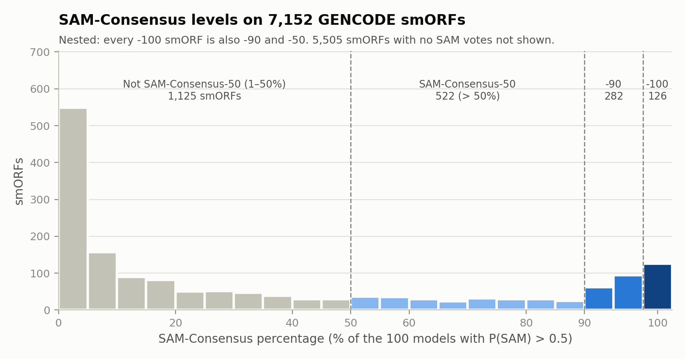
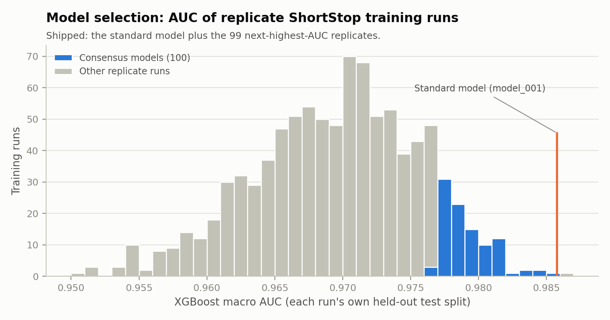
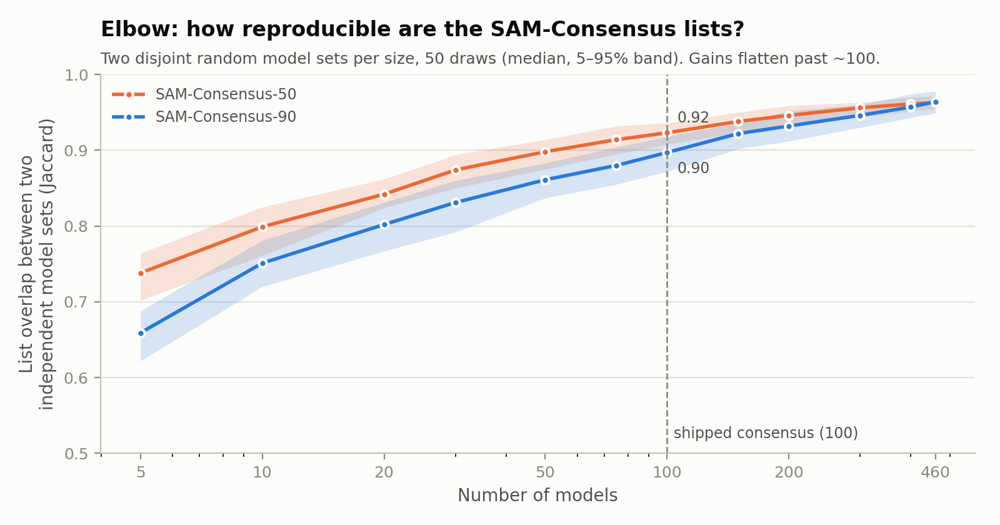

<p align="center">
  
</p>

<div align="center">
<table>
<tr><td align="center">
<b>ShortStop v1.2 classifications of the TransCODE Consortium Phase 1 smORF set</b><br/><br/>
<a href="https://github.com/brendan-miller-salk/ShortStop/releases/download/v1.2.0/shortstop_v1.2_gencode_smorfs_classifications.csv"></a>
<p>SAM and SAM-Consensus-50/90/100 labels for every smORF<br/>
from <a href="https://doi.org/10.1038/s41587-022-01369-0">Mudge et al., 2022, <i>Nature Biotechnology</i></a></p>
</td></tr>
</table>
</div>

## What is ShortStop?

**ShortStop** is a machine learning framework for identifying smORF-encoded microproteins (<150 aa) that share biochemical similarity to highly annotated microproteins (i.e., annotated in UniProt/Swiss-Prot) or random smORFs generated stochastically. It specifically classifies smORFs as the following:

- **SAMs** (Swiss-Prot Analog Microproteins): smORFs that resemble microproteins in Swiss-Prot, the reviewed section of the UniProt Knowledgebase.
- **PRISMs** (Physicochemically Resembling In Silico Microproteins): smORFs that resemble stochastically generated sequences with no evolutionary history. See below for more information on PRISMs.

### In silico PRISMs: a matched stochastic baseline

ShortStop generates the in silico PRISMs used during training and treats these as the negative/null hypothesis set. The core feature of ShortStop is precisely these PRISMS. These PRISMs are random sequences, but they are best described as stochastic, because they are generated specifically by matching the length and composition of smORFs you chose (e.g., a set of ribosome profiled smORFs). In our case, for the standard ShortStop prediction model and consensus models, we generated silico PRISMs matched in length and composition to the combined set of the TransCODE 7,264 translating smORFs ([Mudge et al., 2022](https://doi.org/10.1038/s41587-022-01369-0)) and UniProt/Swiss-Prot microproteins (<150 aa). 

---

## Why Use ShortStop?

Thousands of smORFs are actively translated in the human transcriptome, yet the functions of their encoded microproteins remain unknown.

Protein function is conventionally inferred from evidence of evolutionary selection. However, most encoded microproteins are evolutionarily young and lack detectable sequence conservation across species.

ShortStop provides a homology-independent approach to identify microproteins that share key physicochemical properties with known proteins, even in the absence of sequence similarity.

Stochastic smORF-encoded microprotein sequences like these offer a natural null model for asking whether putative microproteins differ from chance. For example, [Heames et al. (2023)](https://doi.org/10.1038/s41559-023-02010-2) compared putative human and fly de novo proteins with synthetic, unevolved sequences of matched length and composition. They found similar predicted biophysical properties but moderately higher solubility in vitro. In silico PRISMs provide this kind of matched baseline for any smORF catalog, for example as negative controls in screens, as a reference for structure or disorder predictions, or to test whether a property of translated smORFs exceeds stochastic expectation.

ShortStop classifications and in silico PRISMs support hypothesis-driven studies to "deorphanize" the function of translating smORFs. They also provide a foundation for benchmarking new algorithms and methods as data emerge from ongoing studies.


---

## Key Features

- Classifies smORFs as SAMs or PRISMs using a pre-trained ML model
- Generates stochastic, length- and composition-matched in silico PRISMs (negative control microprotein sequences)
- Extracts physicochemical features from input smORFs
- Supports model training, prediction, and feature extraction as CLI modules

---

## Requirements

You’ll need:

1. A GTF file of smORFs that must contain CDS and transcripts features
2. A matched reference genome (e.g., hg38, which automatically downloads upon initiating demo mode).

---

## Installation

> ✅ Optionally create a conda environment (recommended):
> ```bash
> conda create -n shortstop python=3.9
> conda activate shortstop
> ```

### Option 1 – Direct from GitHub (recommended)
```bash
pip install git+https://github.com/brendan-miller-salk/ShortStop.git
```

### Option 2 – Clone and Install Locally
```bash
git clone https://github.com/brendan-miller-salk/ShortStop.git
cd ShortStop
pip install .
```

### ⚠️ If you get a C compilation error during install...
Install a C compiler for your system:

- **Ubuntu/Debian**
  ```bash
  sudo apt-get install build-essential
  ```

- **Fedora/CentOS**
  ```bash
  sudo dnf install gcc
  ```

- **Arch Linux**
  ```bash
  sudo pacman -S base-devel
  ```

- **Windows**  
  Download and install: [Microsoft C++ Build Tools](https://visualstudio.microsoft.com/visual-cpp-build-tools/)

---

## Quickstart (Demo Mode)

Run the built-in demo, which exercises all core modules:

```bash
shortstop demo
```

If reference genome are not provided manually, they will be auto-downloaded into the source code directory. These file in total are ~5 GB.

To manually specify references and avoid downloads:

```bash
shortstop demo \
  --genome demo_data/hg_38_primary.fa \
  --positive_gtf demo_data/gencode.v43.primary_assembly.basic.annotation.gtf
```

Estimated run time is 5 minutes.

---

## Usage

### Predict Mode

```bash
shortstop predict -h
```

Classifies smORFs as `SAM:intracellular`, `SAM:secreted`, or `PRISM`

Prediction takes approximately 5-10 minutes per 10,000 smORF sequences. It is recommended to parallelize (e.g., on a cluster) if attempting to classify >1 million sequences.

#### SAM-Consensus (v1.2)

Training ShortStop involves random sampling: which in silico PRISMs are generated, and how the data are split for training and testing. Retraining therefore gives a slightly different SAM list each time. To show how robust each SAM call is, predict mode also scores every smORF with **100 independently trained ShortStop models**. The standard model's classification is unchanged, and the standard model is one of the 100 (`model_001`).

Each consensus model votes SAM when P(SAM) = P(intracellular) + P(secreted) > 0.5. Every smORF gets a **SAM-Consensus percentage** (the share of the 100 models voting SAM) and four yes/no labels:

| Label | Rule | TransCODE Phase 1 smORFs (n = 7,152) |
|---|---|---|
| **SAM** | standard model classification (unchanged from v1.0) | 604 |
| **SAM-Consensus-50** | > 50% of the 100 models vote SAM | 522 |
| **SAM-Consensus-90** | ≥ 90% of models | 282 |
| **SAM-Consensus-100** | all 100 models | 126 |

Per-smORF results for these TransCODE Consortium Phase 1 smORFs ([Mudge et al., 2022](https://doi.org/10.1038/s41587-022-01369-0)) are attached to the v1.2.0 release: [shortstop_v1.2_gencode_smorfs_classifications.csv](https://github.com/brendan-miller-salk/ShortStop/releases/download/v1.2.0/shortstop_v1.2_gencode_smorfs_classifications.csv).

The SAM-Consensus labels are nested: every SAM-Consensus-100 smORF is also -90 and -50. Use SAM-Consensus-90 or -100 when you need the most robust set, such as when choosing candidates for experiments. 438 of the 604 standard SAMs are also SAM-Consensus-50; the other 166 depend on the particular training sample.

<picture>
  <source media="(prefers-color-scheme: dark)" srcset="docs/figures/consensus_levels_dark.png">
  
</picture>

The consensus models (~37 MB) are downloaded and checksum-verified on the first run:

```bash
shortstop predict ... --no_consensus           # standard model only (v1.0 behavior)
shortstop predict ... --consensus_dir /path    # use or download the bundle here (offline / shared installs)
```

**How the 100 models were chosen.** ShortStop was trained 1,000 times with the v1.2 sequence extraction, each time on an independent random PRISM sample and train/test split. The consensus models are the standard model plus the 99 highest of these runs by XGBoost macro AUC (AUC 0.979–0.987, each measured on that run's own held-out test split). The in silico PRISMs each model was trained against are attached to the v1.2.0 release.

<picture>
  <source media="(prefers-color-scheme: dark)" srcset="docs/figures/consensus_auc_dark.png">
  
</picture>

**Why 100 models.** Take two sets of 100 models built from completely separate training runs: their SAM-Consensus-50 lists overlap 93% (Jaccard) and their SAM-Consensus-90 lists 89%. More models add little.

<picture>
  <source media="(prefers-color-scheme: dark)" srcset="docs/figures/consensus_elbow_dark.png">
  
</picture>

**Agreement between individual models.** On TransCODE Phase 1 smORFs, each model votes SAM for a median of 570 smORFs (range 439–832). Any two models' SAM lists overlap by Jaccard 0.576 on average, and Fleiss' κ is 0.707 ("substantial"). The models learn a consistent signal, but a single model's SAM list is only partly reproducible, which is why the SAM-Consensus labels are reported.

Agreement measures robustness to the training sample, not correctness: all 100 models share the same positive training set and features, so they can be confidently wrong together. Full results are in [docs/consensus_validation.md](docs/consensus_validation.md).

---

### In Silico Mode

```bash
shortstop insilico -h
```

Generates in silico microprotein sequences matched to your input smORFs by length, amino acid, and nucleic acid composition

---

### Feature Extraction

```bash
shortstop feature_extract -h
```

Extract nucleotide and amino acid features from smORFs.

---

### Training Mode

```bash
shortstop train -h
```

Train a custom classifier from your own positive/negative examples.

---

## Output Structure

```
shortstop_output/
├── features/
│   └── extracted_features_of_smorfs.csv
├── predictions/
│   ├── sam_secreted.csv
│   ├── sam_intracellular.csv
│   ├── prisms.csv
│   ├── sams.csv
│   ├── shortstop_classifications.csv
│   └── consensus/
│       ├── shortstop_consensus.csv   # one row per smORF: SAM + SAM-Consensus-50/90/100
│       └── consensus_summary.txt     # label counts and model agreement for this run
├── sequences/
│   ├── positive_unknown_insilico_sequences.csv
│   ├── positive_and_unknown_sequences.csv
│   ├── unknown_sequences.csv
│   └── positive_proteins.gtf
```

---

## Contact

ShortStop is in continuous development. For any questions or suggestions, contact [brmiller@salk.edu](mailto:brmiller@salk.edu) or open an issue on GitHub.

---

## Citation

If you used ShortStop, please cite it in your manuscript:  
Miller B, de Souza EV, Pai VJ, Kim H, Vaughan JM, Lau CJ, Diedrich JK, Saghatelian A. ShortStop: a machine learning framework for microprotein discovery. *BMC Methods* 2, 16 (2025). [doi:10.1186/s44330-025-00037-4](https://doi.org/10.1186/s44330-025-00037-4)

The TransCODE Consortium Phase 1 smORFs classified above are from:  
Mudge JM, Ruiz-Orera J, Prensner JR, et al. Standardized annotation of translated open reading frames. *Nat Biotechnol* 40, 994–999 (2022). [doi:10.1038/s41587-022-01369-0](https://doi.org/10.1038/s41587-022-01369-0)

## License and Contributions

This project is licensed for **non-commercial academic research use only**.  
See [LICENSE.md](./LICENSE.md) for full terms.

By contributing to this repository, you agree to the [Contributor License Agreement (CLA)](./CLA.md).  

Please read our [CONTRIBUTING.md](./CONTRIBUTING.md) before submitting code or issues.

For commercial licensing inquiries, contact [brmiller@salk.edu](mailto:brmiller@salk.edu). By downloading or using this tool, you agree to the terms in LICENSE.md and CLA.md.
